# Louis · Arte e animação

Referências e produção de sprites para MMO RPG 2D isométrico, com identidade visual congelada e objetivo de oito direções.

**4 de 4 direções cardeais com arte + Idle disponíveis** · **8 de 8 artes estáticas · 8 de 8 pares arte + Idle**
Conferência do inventário e dos registros em **11/11/2026**, considerando as referências originais como a direção frontal (S).

## Inventário por direção

| Direção de tela | Arte estática oficial | Folha Idle · 8 quadros | Registro / situação |
|---|---|---|---|
| **S · Frente** | [Arte frontal congelada](referencias/arte%20congelada%20Louis.png) | [Idle frontal original](referencias/Idle%20front%20Louis.png) | Referências recebidas e preservadas; [arte](Arte%20Louis.md) e [movimento](Padr%C3%A3o%20de%20movimenta%C3%A7%C3%A3o%20Louis.md) |
| **N · Costas** | [Costas parada v2](artes/louis-costas-parado-v2.png) | [Idle N v1](animacoes/louis-idle-n-v1.png) | Aprovados e congelados · [arte](artes/louis-costas-parado-v2.md) · [Idle](animacoes/louis-idle-n-v1.md) |
| **E · Leste / direita** | [Leste parado v1](artes/louis-leste-parado-v1.png) | [Idle E v1](animacoes/louis-idle-e-v1.png) | Aprovados e congelados · [arte](artes/louis-leste-parado-v1.md) · [Idle](animacoes/louis-idle-e-v1.md) |
| **W · Oeste / esquerda** | [Oeste parado v1](artes/louis-oeste-parado-v1.png) | [Idle W v1](animacoes/louis-idle-w-v1.png) | Aprovados e congelados · [arte](artes/louis-oeste-parado-v1.md) · [Idle](animacoes/louis-idle-w-v1.md) |
| **SE · Sudeste / frente-direita** | [Sudeste parado v1](artes/louis-sudeste-parado-v1.png) | [Idle SE v1](animacoes/louis-idle-se-v1.png) | Arte e Idle aprovados e congelados · [L3.1](artes/louis-sudeste-parado-v1.md) · [L3.2](animacoes/louis-idle-se-v1.md) |
| **SW · Sudoeste / frente-esquerda** | [Sudoeste parado v1](artes/louis-sudoeste-parado-v1.png) | [Idle SW v1](animacoes/louis-idle-sw-v1.png) | Arte e Idle aprovados e congelados · [L3.3](artes/louis-sudoeste-parado-v1.md) · [L3.4](animacoes/louis-idle-sw-v1.md) |
| **NE · Nordeste / costas-direita** | [Nordeste parado v1](artes/louis-nordeste-parado-v1.png) | [Idle NE v1](animacoes/louis-idle-ne-v1.png) | Arte e Idle aprovados e congelados · [L3.5](artes/louis-nordeste-parado-v1.md) · [L3.6](animacoes/louis-idle-ne-v1.md) |
| **NW · Noroeste / costas-esquerda** | [Noroeste parado v1](artes/louis-noroeste-parado-v1.png) | [Idle NW v1](animacoes/louis-idle-nw-v1.png) | Arte e Idle aprovados e congelados · [L3.7](artes/louis-noroeste-parado-v1.md) · [L3.8](animacoes/louis-idle-nw-v1.md) |

“Completo” nesta conferência significa **um par de arte estática + folha Idle por direção**. **SE** possui arte e Idle aprovados e congelados (L3.1/L3.2). **SW** possui arte aprovada e congelada em L3.3, com Idle aprovado e congelado em L3.4. **NE** possui arte e Idle aprovados e congelados em L3.5/L3.6; **NW** possui arte e Idle aprovados e congelados em L3.7/L3.8, completando os oito pares. Oito quadros de animação não significam oito direções.

## Galeria de Idle

As oito direções possuem GIFs publicados e são exibidas abaixo. O GIF frontal foi enviado pelo usuário em 10/11/2026 e preservado sem alteração; [registro e procedência](animacoes/louis-idle-s-v1.md).

| Frente · S | Costas · N |
|:---:|:---:|
| <a href="animacoes/louis-idle-s-v1.gif">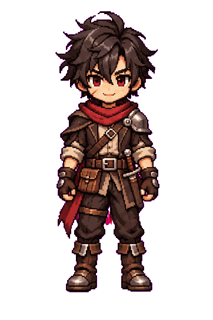</a> | <a href="animacoes/louis-idle-n-v1.gif">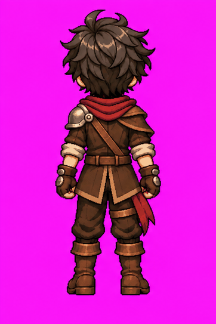</a> |
| **Leste · E** | **Oeste · W** |
| <a href="animacoes/louis-idle-e-v1.gif">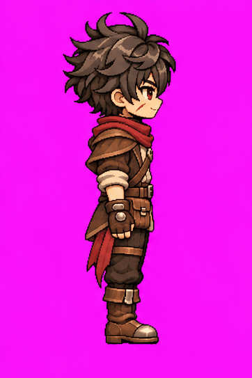</a> | <a href="animacoes/louis-idle-w-v1.gif">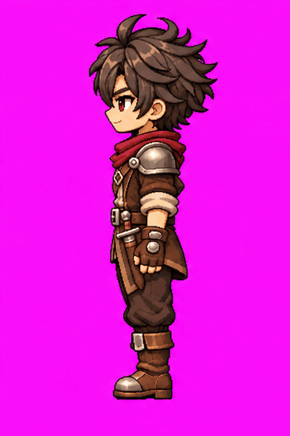</a> |
| **Sudeste · SE** | **Sudoeste · SW** |
| <a href="animacoes/louis-idle-se-v1.gif">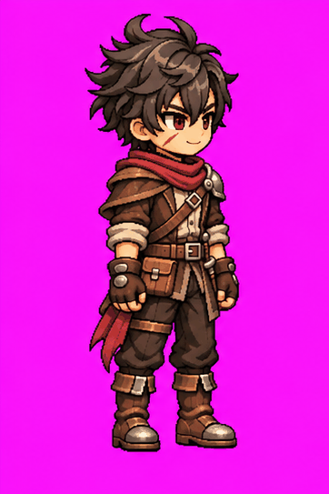</a> | <a href="animacoes/louis-idle-sw-v1.gif">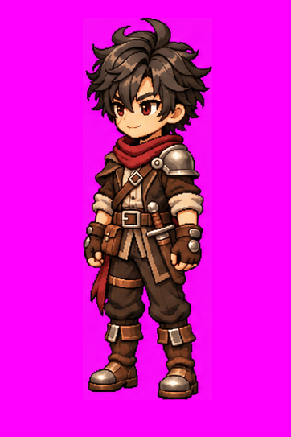</a> |
| **Nordeste · NE** | **Noroeste · NW** |
| <a href="animacoes/louis-idle-ne-v1.gif">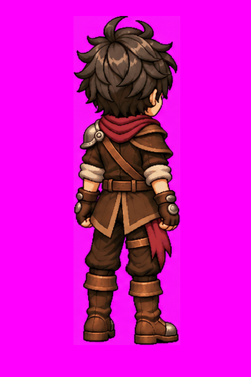</a> | <a href="animacoes/louis-idle-nw-v1.gif">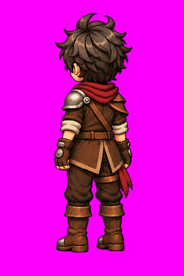</a> |

## Galeria de artes congeladas

| Frente · S | Costas · N (v2) |
|:---:|:---:|
|  | <a href="artes/louis-costas-parado-v2.png">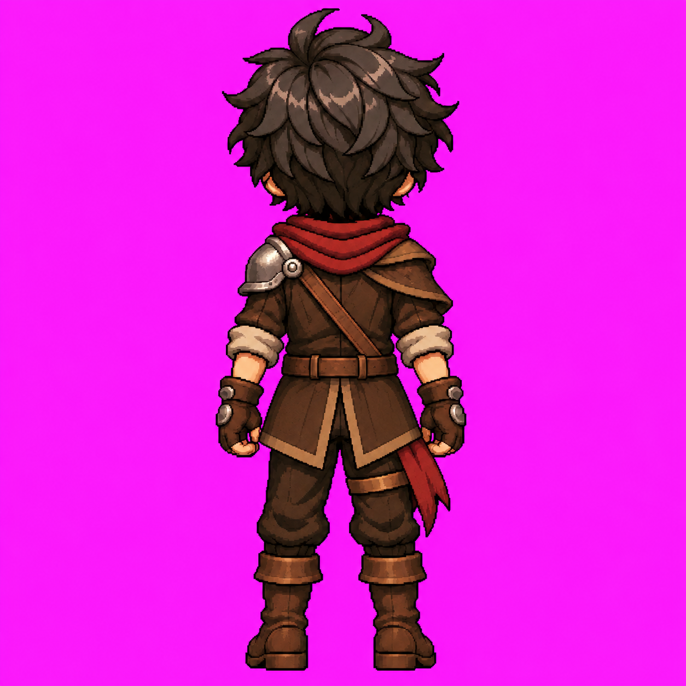</a> |
| **Leste · E** | **Oeste · W** |
| <a href="artes/louis-leste-parado-v1.png">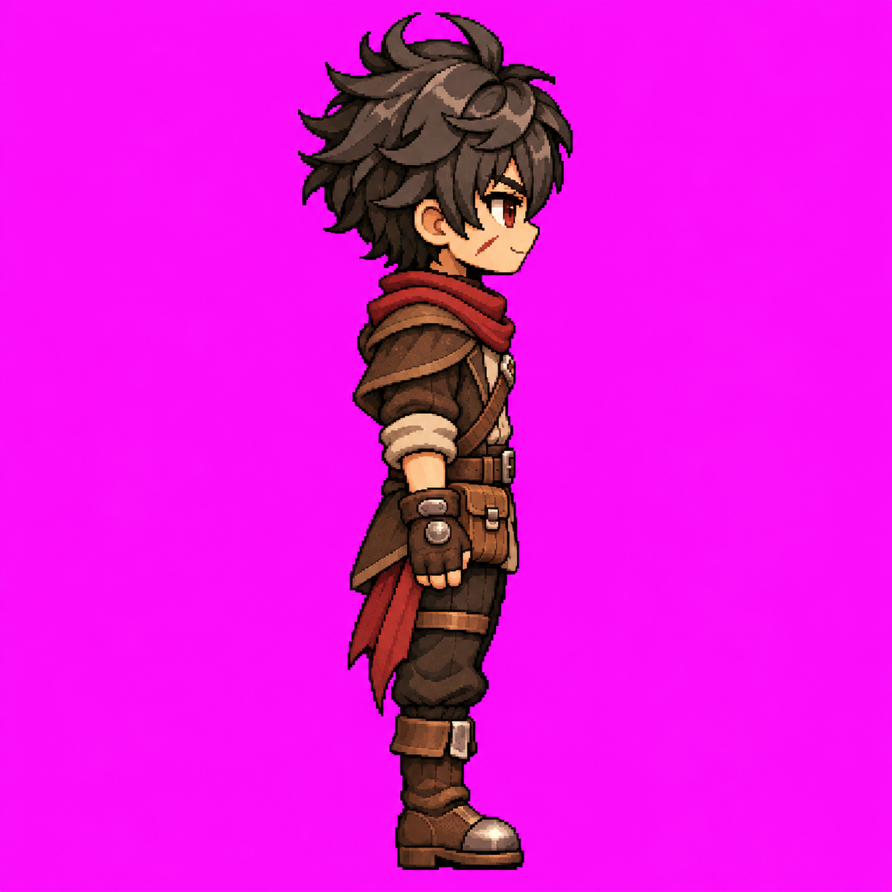</a> | <a href="artes/louis-oeste-parado-v1.png">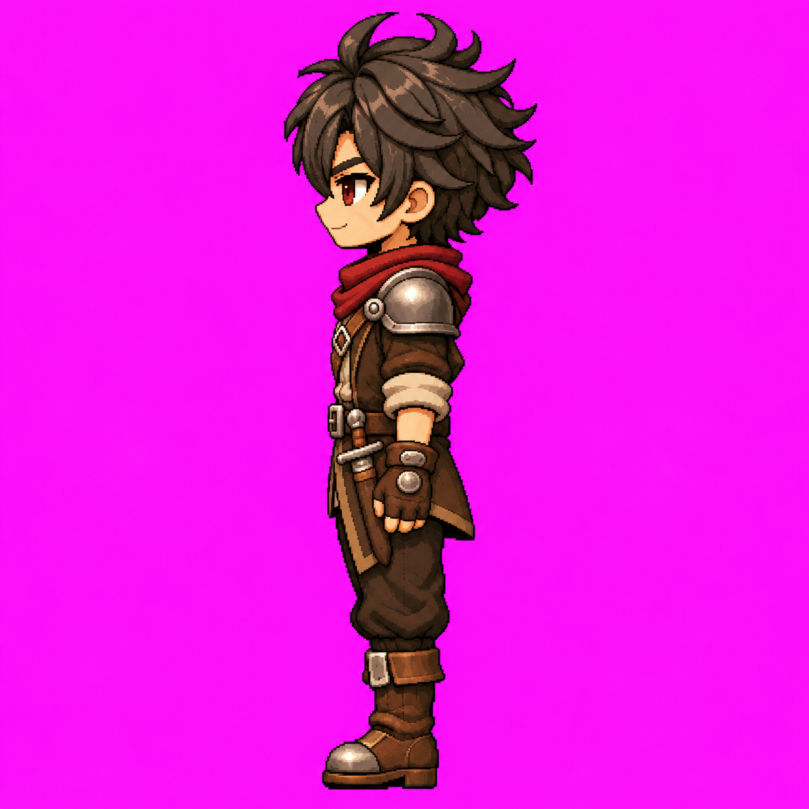</a> |
| **Sudeste · SE** | **Sudoeste · SW** |
| <a href="artes/louis-sudeste-parado-v1.png">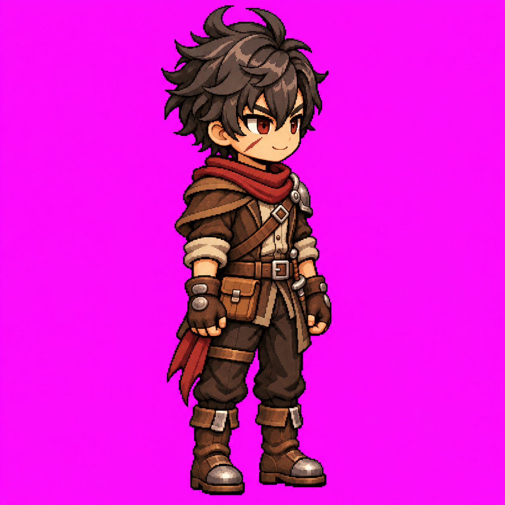</a> | <a href="artes/louis-sudoeste-parado-v1.png">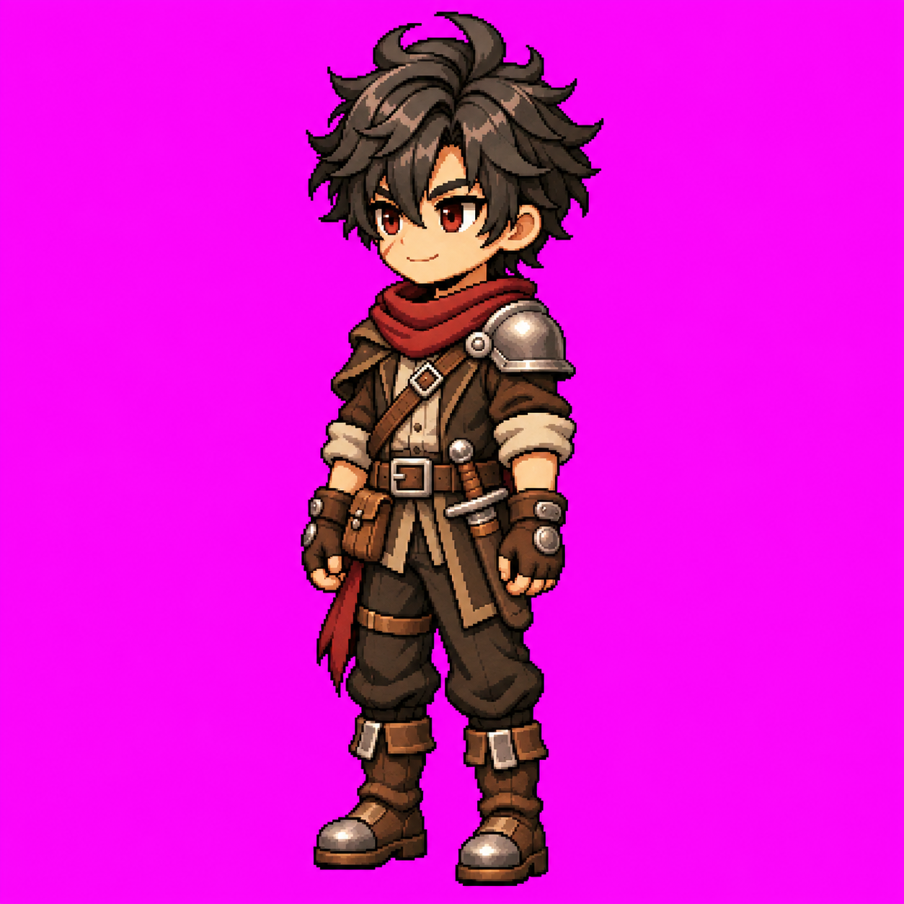</a> |
| **Nordeste · NE** | **Noroeste · NW** |
| <a href="artes/louis-nordeste-parado-v1.png">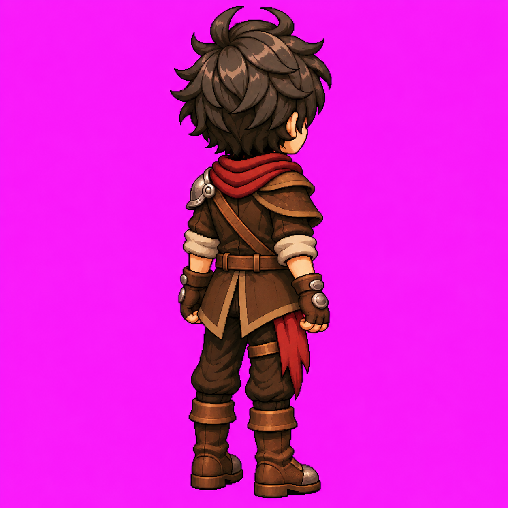</a> | <a href="artes/louis-noroeste-parado-v1.png">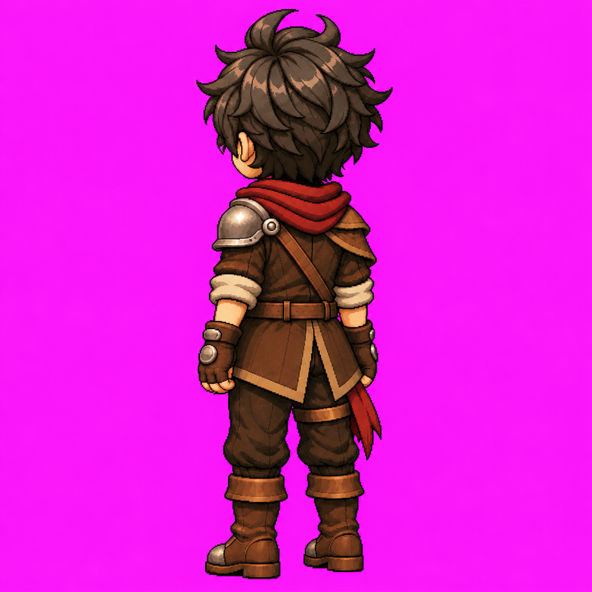</a> |

## Especificações e uso

| Material | Especificação documentada |
|---|---|
| Artes estáticas oficiais | 1254 × 1254 px, pose única |
| Folhas Idle S / N / E / W / SE | 1448 × 1086 px, grade 4 × 2, oito quadros |
| Folhas Idle SW / NE / NW originais | 1491 × 1055 px, disposição 4 × 2; exceções documentadas em L3.4/L3.6/L3.8 |
| Célula de animação | 362 × 543 px; leitura por linhas |
| GIFs S / N / E / W / SE / SW / NE / NW | 120 ms/quadro, ciclo de 960 ms; prévias |
| Fundo | Magenta opaco com variações; fontes RGB ou RGBA com alfa opaco |
| Integração | Transparência, atlas, pivôs e validação em motor pendentes (L5) |

Aprovação visual e congelamento não certificam ancoragem exata nem integração no jogo. O timing dos GIFs é de prévia; o PNG frontal não fornece timing original. Preservar os originais: alterações exigem nova versão e aprovação.

**Assimetria obrigatória:** não espelhar E para obter W. Ombreira metálica e adaga pertencem ao lado esquerdo anatômico; bolsa, faixa e tira da coxa ao direito. Bolsa e adaga são anteriores e ficam ocultas na vista posterior neutra. Usar sempre a **arte posterior v2**; v1 é histórico superado. Consultar o [contrato de oclusão](docs/oclusao-equipamentos.md) e seu [JSON](docs/oclusao-equipamentos.json).

## Padrão obrigatório das galerias

Manter as artes e os GIFs em suas respectivas tabelas de **duas colunas**, com títulos por direção e conteúdo centralizado. Ordem fixa das linhas: **S/N, E/W, SE/SW, NE/NW**. Artes com largura de exibição de **260 px**; GIFs com **240 px**, preservando a proporção. Cada prévia deve abrir seu arquivo original ao clicar. Direções ainda não publicadas devem mostrar “Pendente — a produzir”. Inserir novas publicações na célula correspondente, sem imagens soltas ou duplicadas ao final do README. Essa regra altera somente a apresentação, nunca os arquivos aprovados.

## Documentação e inventário

| Caminho | Conteúdo |
|---|---|
| [Arte Louis.md](Arte%20Louis.md) | Identidade, materiais, lateralidade, paleta e fidelidade |
| [Padrão de movimentação Louis.md](Padr%C3%A3o%20de%20movimenta%C3%A7%C3%A3o%20Louis.md) | Grade, oito quadros, ancoragem proposta e contrato de produção |
| [referencias/](referencias/) | Arte frontal e Idle frontal originais |
| [artes/](artes/) | Artes N v1 histórica / N v2 oficial / E v1 / W v1 / SE v1 / SW v1 / NE v1 / NW v1 e registros |
| [animacoes/](animacoes/) | Idle N / E / W / SE / SW / NE / NW: PNG, GIF, registro Markdown e metadados JSON; GIF frontal S, registro e metadados (folha S em referencias/) |
| [prompts/](prompts/) | Prompts literais recuperados de N estático v1/v2, E estático/Idle e W / SE / SW / NE / NW estáticos; Idle SE e SW |
| [docs/](docs/) | Regra de oclusão em Markdown e contrato JSON |
| [analise/medicoes.json](analise/medicoes.json) | Dimensões, hashes e caixas das referências originais |
| [analise/medir.py](analise/medir.py) | Reprodução das medidas com Python, Pillow e NumPy |
| [roadmap.md](roadmap.md) | Etapas concluídas e pendentes |
| [state.ai](state.ai) | Estado e decisões para retomada |

**Procedência:** prompts literais dos Idles N, W, NE e NW não foram recuperados; os das referências recebidas não foram fornecidos. Essas lacunas não devem ser preenchidas com reconstruções apresentadas como originais. Metadados dos Idles: [S](animacoes/louis-idle-s-v1.json), [N](animacoes/louis-idle-n-v1.json), [E](animacoes/louis-idle-e-v1.json), [W](animacoes/louis-idle-w-v1.json), [SE](animacoes/louis-idle-se-v1.json), [SW](animacoes/louis-idle-sw-v1.json), [NE](animacoes/louis-idle-ne-v1.json), [NW](animacoes/louis-idle-nw-v1.json).

## Próximas etapas — Walk Cycle suave

**Idle concluído nas oito direções. Walk: 0/8 direções produzidas.** Próxima fase: **L3.W**, locomoção de L3, com **16 frames por direção: oito por passo**, total de 128 frames. Run fica para uma fase futura.

[Planejamento completo, fases, escala, oclusão e critérios de aprovação](docs/l3-w-planejamento-walk-cycle.md).

| Etapa | Entrega | Estado |
|---|---|---|
| L3.W0 | Planejamento do Walk de 16 frames | Publicado |
| L3.W1 | Walk E piloto + GIF | Próxima produção |
| L3.W2 | Walk W + GIF | Pendente |
| L3.W3 | Walk S + GIF | Pendente |
| L3.W4 | Walk N + GIF | Pendente |
| L3.W5 | Walk SE + GIF | Pendente |
| L3.W6 | Walk SW + GIF | Pendente |
| L3.W7 | Walk NE + GIF | Pendente |
| L3.W8 | Walk NW + GIF | Pendente |
| L3.W9 | Conferência final: oito direções / 128 frames | Pendente |

Formato planejado: células **362 × 543 px**, folha **4 × 4 / 1448 × 2172 px**, sem reduzir o personagem. Se necessário, ampliar uniformemente o canvas para preservar a escala e evitar cortes. Prévia inicial proposta: **80 ms/frame / 1280 ms por ciclo**, a validar no piloto. Movimento de mãos, braços, ombros, cintura, pernas e roupa; apoio contínuo e oclusão por quadro.

Uma direção por etapa, seguida de aprovação, congelamento e publicação dos arquivos e registros. Próxima produção: **L3.W1 — Walk E piloto**. Este planejamento não gerou animações. Galeria Walk futura seguirá duas colunas e ordem S/N, E/W, SE/SW, NE/NW.

L4 continua reservada a ataques/skills; L5 a transparência, atlas, pivôs e testes em motor. [Conferência do Idle L3.9](docs/l3-9-conferencia-oito-direcoes.md).

> Os registros datados abaixo preservam o estado de cada publicação; o estado atual consta em L3.9 e no inventário.

## L3.4 — Idle Sudoeste (SW) aprovado e congelado — 10/11/2026

[Folha original PNG](animacoes/louis-idle-sw-v1.png), [GIF aprovado](animacoes/louis-idle-sw-v1.gif), [registro](animacoes/louis-idle-sw-v1.md), [metadados e hashes](animacoes/louis-idle-sw-v1.json) e [prompt literal](prompts/louis-idle-sw-v1.txt).

Aprovação explícita: “Aprovados! publique e atualize documentação + readme usando a conexão github”. PNG e GIF aprovados preservados sem alteração nesta publicação; mudanças exigem nova versão e aprovação. Arte SW v1 é a autoridade estática; Idle frontal e Oeste são referências de movimento. Assimetria e contrato de oclusão permanecem obrigatórios.

**Exceção de formato:** o prompt solicitou 1448 × 1086, mas a folha efetivamente gerada e aprovada mede **1491 × 1055 px**, oito quadros em disposição 4 × 2; os limites proporcionais arredondados produzem células de larguras 372/373 e alturas 527/528 px. Não tratar esta fonte como atlas regular de células 362 × 543. O GIF aprovado mede 362 × 543 px, oito frames, 120 ms/quadro e ciclo de 960 ms. Na composição anterior à aprovação, as células foram recortadas, o conteúdo recebeu um fator uniforme comum para altura máxima de 480 px e foi centralizado aproximadamente em x=183, com base y=496. Fundo magenta opaco. A folha original não foi redimensionada nesta publicação.

**L3.4 concluída: 6/8 pares arte + Idle (S/N/E/W/SE/SW).** Faltam NE e NW. Próxima etapa: **L3.5 — Arte estática NE**, conforme sequência de produção; aguardar instrução do usuário. Locomoção, transparência, atlas e validação em motor permanecem pendentes. Timing do GIF é de prévia.

## L3.5 — Arte Nordeste (NE) aprovada e congelada — 10/11/2026

[Arte NE v1](artes/louis-nordeste-parado-v1.png), [registro](artes/louis-nordeste-parado-v1.md), [metadados e hash](artes/louis-nordeste-parado-v1.json) e [prompt literal](prompts/louis-nordeste-parado-v1.txt). Pose única em três quartos costas/direita, 1254 × 1254 px, RGB, fundo magenta opaco. Aprovação explícita: “arte aprovada!congele e publique. atualize tbm as documentações + readme seguindo o nosso padrão.” PNG original preservado sem edição, recorte ou redimensionamento; alterações exigem nova versão e aprovação.

Costas v2 + Leste são as autoridades principais; arte frontal e Idle frontal são referências complementares. Lado direito anatômico próximo, ombro de couro; ombreira metálica única à esquerda anatômica, distante e parcialmente visível. Bolsa e adaga anteriores ocultas pelo corpo/casaco; faixa bordô lateral/posterior direita e tira da coxa preservadas. Correia posterior do ombro esquerdo ao quadril direito, sem fivela frontal nas costas. Superfícies intermediárias são interpretações da rotação agora aprovada, sem definir novo ângulo de câmera.

**L3.5 concluída: 7/8 artes estáticas e 6/8 pares arte + Idle (S/N/E/W/SE/SW).** Idle NE e arte + Idle NW pendentes. Próxima etapa proposta: **L3.6 — Idle NE + GIF de validação**, usando a arte NE aprovada e os Idles costas/Leste. Aguardar instrução para produzir. Locomoção, transparência, atlas e validação em motor permanecem pendentes.

## L3.6 — Idle Nordeste (NE) publicado e congelado — 11/11/2026

[Folha PNG](animacoes/louis-idle-ne-v1.png), [GIF aprovado](animacoes/louis-idle-ne-v1.gif), [registro](animacoes/louis-idle-ne-v1.md) e [metadados e hashes](animacoes/louis-idle-ne-v1.json) disponíveis. Binários enviados pelo usuário em `823a187` (“etapa manual”); hashes conferidos contra os originais recuperados. Folha RGB 1491 × 1055 px, oito quadros em disposição 4 × 2, com exceção de formato; GIF 362 × 543 px, oito frames de 120 ms, ciclo de 960 ms. Nenhum binário modificado nesta revisão. Prompt literal não recuperado; não inventar.

**Estado atual: 7/8 artes e 7/8 pares arte + Idle (S/N/E/W/SE/SW/NE).** Faltam arte e Idle NW. Próxima etapa proposta: **L3.7 — arte estática NW**, depois L3.8 — Idle NW + GIF, mediante instrução. Locomoção continua pendente em L3; transparência, atlas, pivôs e validação no motor em L5.

## Auditoria de integridade — 11/11/2026

[Relatório](docs/auditoria-integridade-2026-11-11.md) e [medições](analise/integridade.json). O commit manual restaurou o **PNG Oeste (W)**, que agora decodifica integralmente e corresponde ao hash previamente documentado. O PNG SW não mudou nesse commit e abre completo. Fontes preservadas; lacunas conhecidas e limites da revisão registrados no relatório.

## L3.7 — Arte Noroeste (NW) aprovada e congelada — 11/11/2026

[Arte NW v1](artes/louis-noroeste-parado-v1.png), [registro](artes/louis-noroeste-parado-v1.md), [metadados e hash](artes/louis-noroeste-parado-v1.json) e [prompt literal](prompts/louis-noroeste-parado-v1.txt). Pose única em três quartos costas/esquerda, 1254 × 1254 px, RGB, fundo magenta opaco. Aprovação explícita: “arte aprovada! congele e publique. atualize também as documentações e readme.” PNG original preservado sem edição, recorte ou redimensionamento; alterações exigem nova versão e aprovação.

Costas v2 + Oeste são as autoridades principais; arte frontal e Idle frontal complementam identidade, proporções e renderização. Ombreira prateada única no lado esquerdo anatômico próximo; couro no ombro direito distante. Correia posterior do ombro esquerdo ao quadril direito, sem fivela frontal nas costas. Bolsa anterior direita e adaga anterior esquerda ocultas pelo corpo/casaco/braços; faixa bordô e tira da coxa mantidas à direita anatômica, com visibilidade independente. Superfícies intermediárias são interpretações da rotação agora aprovada. Não espelhar NE.

**Estado atual: 8/8 artes estáticas aprovadas e 7/8 pares arte + Idle.** Falta o Idle NW. Próxima etapa: **L3.8 — Idle NW + GIF de validação**, usando a arte NW aprovada e os Idles costas/Oeste, mediante instrução. Locomoção nas oito direções continua pendente em L3; transparência, atlas, pivôs e validação no motor em L5.

## L3.8 — Idle Noroeste (NW) aprovado e congelado — 11/11/2026

[Folha PNG](animacoes/louis-idle-nw-v1.png), [GIF aprovado](animacoes/louis-idle-nw-v1.gif), [registro](animacoes/louis-idle-nw-v1.md) e [metadados e hashes](animacoes/louis-idle-nw-v1.json) publicados. Binários enviados pelo usuário no commit `589e5d8` (“etapa manual 2”); registro e JSON completados em `8bf8bbe`. PNG e GIF preservados integralmente.

Folha RGB de **1491 × 1055 px**, oito quadros em disposição **4 × 2**, leitura por linhas. Exceção de formato: não é atlas regular de células 362 × 543. GIF de **362 × 543 px**, oito frames de **120 ms**, ciclo de **960 ms**, loop infinito. Decodificação integral e hashes registrados no JSON. Prompt literal não recuperado; não reconstruir como original.

Autoridade estática: arte NW v1; movimento: Idle N e Idle W. Respeitar assimetria e contrato de oclusão, sem espelhar NE. Ombreira prateada à esquerda anatômica próxima; bolsa e adaga anteriores predominantemente ocultas pelo corpo/casaco/braços; faixa e tira da coxa permanecem à direita anatômica.

**Estado atual: 8/8 artes estáticas e 8/8 pares arte + Idle (S/N/E/W/SE/SW/NE/NW).** O repouso nas oito direções está completo. **L3 permanece em andamento pela locomoção**; próxima ação/direção a definir mediante instrução do usuário. Transparência, atlas, pivôs e validação em motor permanecem pendentes em L5.

## L3.9 — Conferência final das oito direções — 11/11/2026

**Conferência concluída: 8/8 artes oficiais, 8/8 folhas Idle e 8/8 GIFs com registros disponíveis.** [Relatório final](docs/l3-9-conferencia-oito-direcoes.md) e [medições e hashes](analise/integridade-l3-9.json). Todos os 26 arquivos de imagem do repositório decodificam; 64 quadros GIF verificados; nenhuma divergência nos hashes registrados ou link local quebrado. Fontes aprovadas preservadas sem alteração.

SW/NE/NW conservam a exceção de formato 1491 × 1055; GIF S conserva o tratamento diferente da folha; fundo NE apresenta variações. Prompts literais dos Idles N/W/NE/NW continuam não recuperados. Conferência de repouso concluída; L3 geral continua em andamento pela locomoção. Transparência, atlas, pivôs e teste em motor permanecem em L5.
