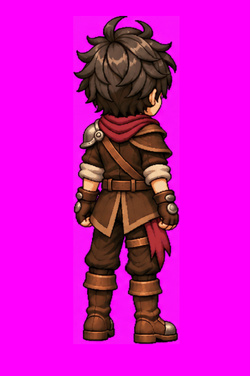

# Louis — Idle NE v1

**APROVADO E CONGELADO — L3.6.** Aprovação em 10/11/2026; publicação completada em 11/11/2026.

[Folha PNG](louis-idle-ne-v1.png) · [GIF de validação](louis-idle-ne-v1.gif) · [Metadados e hashes](louis-idle-ne-v1.json)

Aprovação da conversa de origem: “aprovada! congele, publique e atualize documentação e readme”. Os dois binários foram publicados manualmente pelo usuário no commit `823a187` (“etapa manual”). Seus SHA-256 coincidem com os originais recuperados e documentados anteriormente. Nenhum pixel foi alterado nesta conclusão documental; mudanças exigem nova versão e aprovação.

## Referências e oclusão

Autoridade estática: [arte NE congelada](../artes/louis-nordeste-parado-v1.png). Movimento: [Idle N](louis-idle-n-v1.png) e [Idle E](louis-idle-e-v1.png). Respeitar o [contrato de oclusão](../docs/oclusao-equipamentos.md), sem espelhamento: ombreira à esquerda anatômica; faixa lateral/posterior direita; bolsa e adaga anteriores predominantemente ocultas pelo corpo/casaco nesta vista.

## Medidas verificadas

| Arquivo | Dimensões | Conteúdo |
|---|---|---|
| PNG | 1491 × 1055 px, RGB | Oito quadros em disposição 4 × 2 |
| GIF | 362 × 543 px | Oito frames, 120 ms/frame, ciclo de 960 ms, loop infinito |

**Exceção de formato:** a folha não é um atlas regular de células 362 × 543. Preservar a fonte; recorte, transparência, pivôs e exportação para o motor pertencem a L5. O GIF já aprovado é prévia; não inferir a partir dele coordenadas de recorte exatas para o PNG. Há variação magenta visível no fundo da prévia, preservada do original.

O prompt literal do Idle NE não foi recuperado. Não foi reconstruído nem apresentado como original. Aprovação visual não equivale a validação em motor.

L3.6 concluída: **7/8 pares arte + Idle** (S/N/E/W/SE/SW/NE). Próxima etapa: L3.7, arte estática NW, aguardando instrução.
