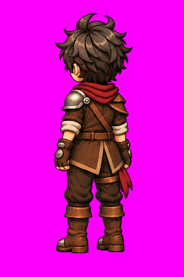

# Louis — Idle NW v1

**APROVADO E CONGELADO — L3.8.** Aprovação e publicação em 11/11/2026.

[Folha PNG](louis-idle-nw-v1.png) · [GIF de validação](louis-idle-nw-v1.gif) · [Metadados e hashes](louis-idle-nw-v1.json)

Aprovação na conversa de origem: “Etapa aprovada! publique e atualize documentação + readme”. Os binários foram publicados manualmente pelo usuário no commit `589e5d8f1aea1d75de210c6f5ed403bd5ab3437b` (“etapa manual 2”). Esta conclusão documental preserva integralmente esses arquivos, sem regeneração, recorte ou redimensionamento. Alterações exigem nova versão e aprovação.

## Referências e oclusão

Autoridade estática: [arte NW congelada](../artes/louis-noroeste-parado-v1.png). Movimento: [Idle N](louis-idle-n-v1.png) e [Idle W](louis-idle-w-v1.png). Aplicar o [contrato de oclusão](../docs/oclusao-equipamentos.md) e seu [JSON](../docs/oclusao-equipamentos.json), sem espelhar NE: ombreira prateada única à esquerda anatômica próxima; ombro direito distante de couro. Bolsa anterior direita e adaga anterior esquerda predominantemente ocultas pelo corpo/casaco/braços. Faixa bordô lateral/posterior e tira da coxa permanecem à direita anatômica, com visibilidade independente. Correia posterior do ombro esquerdo ao quadril direito, sem fivela frontal nas costas.

## Medidas verificadas

| Arquivo | Dimensões | Conteúdo |
|---|---|---|
| PNG | 1491 × 1055 px, RGB | Folha de oito quadros em disposição 4 × 2, leitura por linhas |
| GIF | 362 × 543 px | Oito frames, 120 ms/frame, ciclo de 960 ms, loop infinito |

Os dois arquivos foram decodificados integralmente; os SHA-256 e tamanhos em bytes estão no JSON.

**Exceção de formato:** a folha original não é um atlas regular de células 362 × 543. Preservar a fonte aprovada; recortes exatos, transparência, pivôs e exportação para o motor pertencem a L5. O GIF é uma prévia aprovada, não uma exportação para o motor; suas dimensões não definem coordenadas de recorte no PNG. Fundo magenta opaco preservado.

O prompt literal do Idle NW não foi recuperado nesta publicação. Não reconstruir nem apresentar um novo texto como original. Aprovação visual não equivale a validação em motor.

**L3.8 concluída: 8/8 pares arte + Idle disponíveis (S/N/E/W/SE/SW/NE/NW).** Isso completa as oito direções de repouso. L3 permanece em andamento pela locomoção; transparência, atlas, pivôs e validação em motor continuam pendentes em L5. Aguardar instrução para a próxima produção.
