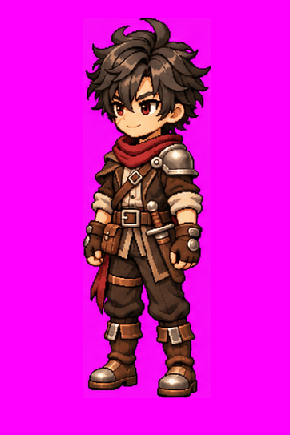

# Louis — Idle SW v1

**APROVADO E CONGELADO — L3.4.**

## L3.4 — Idle Sudoeste (SW) aprovado e congelado — 10/11/2026

[Folha original PNG](louis-idle-sw-v1.png), [GIF aprovado](louis-idle-sw-v1.gif), [registro](louis-idle-sw-v1.md), [metadados e hashes](louis-idle-sw-v1.json) e [prompt literal](../prompts/louis-idle-sw-v1.txt).

Aprovação explícita: “Aprovados! publique e atualize documentação + readme usando a conexão github”. PNG e GIF aprovados preservados sem alteração nesta publicação; mudanças exigem nova versão e aprovação. Arte SW v1 é a autoridade estática; Idle frontal e Oeste são referências de movimento. Assimetria e contrato de oclusão permanecem obrigatórios.

**Exceção de formato:** o prompt solicitou 1448 × 1086, mas a folha efetivamente gerada e aprovada mede **1491 × 1055 px**, oito quadros em disposição 4 × 2; os limites proporcionais arredondados produzem células de larguras 372/373 e alturas 527/528 px. Não tratar esta fonte como atlas regular de células 362 × 543. O GIF aprovado mede 362 × 543 px, oito frames, 120 ms/quadro e ciclo de 960 ms. Na composição anterior à aprovação, as células foram recortadas, o conteúdo recebeu um fator uniforme comum para altura máxima de 480 px e foi centralizado aproximadamente em x=183, com base y=496. Fundo magenta opaco. A folha original não foi redimensionada nesta publicação.

**L3.4 concluída: 6/8 pares arte + Idle (S/N/E/W/SE/SW).** Faltam NE e NW. Próxima etapa: **L3.5 — Arte estática NE**, conforme sequência de produção; aguardar instrução do usuário. Locomoção, transparência, atlas e validação em motor permanecem pendentes. Timing do GIF é de prévia.
