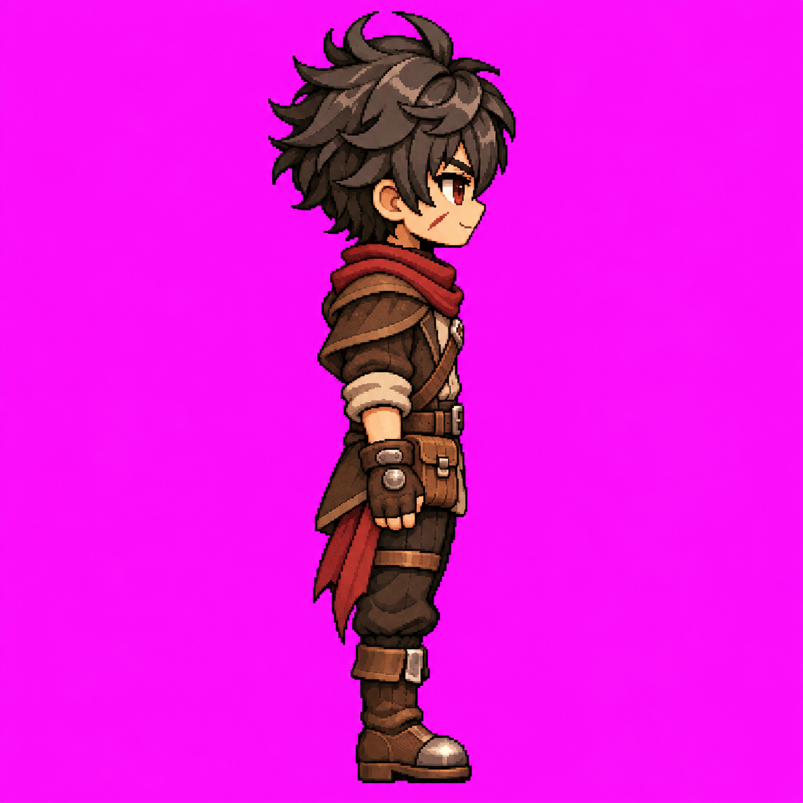

# Louis — Leste parado v1

APROVADO E CONGELADO pelo usuário em 10/11/2026. Direção E: olhando para a direita da tela. Uma arte estática, 1254 × 1254, RGB, fundo magenta opaco. PNG original preservado sem edição, recorte ou redimensionamento. Não sobrescrever: alterações exigem nova versão e aprovação.

## Referências e produção

Gerado com image_gen integrado usando a arte frontal congelada, o idle frontal e a arte posterior v2, após leitura da documentação. [Prompt literal](../prompts/louis-leste-parado-v1.txt). [Metadados e hash](louis-leste-parado-v1.json).

## Lateralidade e oclusão aprovadas

Lado direito anatômico próximo da câmera. Ombro próximo coberto de couro; ombreira metálica esquerda no lado distante, oculta. Bolsa no quadril anterior direito, parcialmente sobreposta pelo braço; faixa bordô direita lateral/posterior pendendo atrás (esquerda da tela). Adaga anterior esquerda oculta no lado distante. Tira da coxa direita no lado próximo. Marca da bochecha direita visível. Membros distantes sobrepostos em perfil neutro.

As superfícies laterais antes não mostradas são interpretações agora aprovadas nesta arte. Aplicar a [regra de fixação e oclusão](../docs/oclusao-equipamentos.md), sem mover equipamentos para favorecer sua visibilidade.

## Uso e limites

Referência oficial estática de E para futuro Idle E, junto das fontes frontal e posterior. Esta aprovação congela a aparência mostrada; não define novos frames, timing, pivô ou export transparente. Idle E v1 aprovado e congelado em 10/11/2026; consultar animacoes/louis-idle-e-v1.md. Não foi validado em motor. Próxima produção depende de instrução do usuário e deve seguir o contrato de movimento existente.

SHA-256: `826524fd83b6b8aac8e9107fd9a12c71558ac3102efe7ad85f174390dd07c372`. Tamanho: 1411727 bytes.
