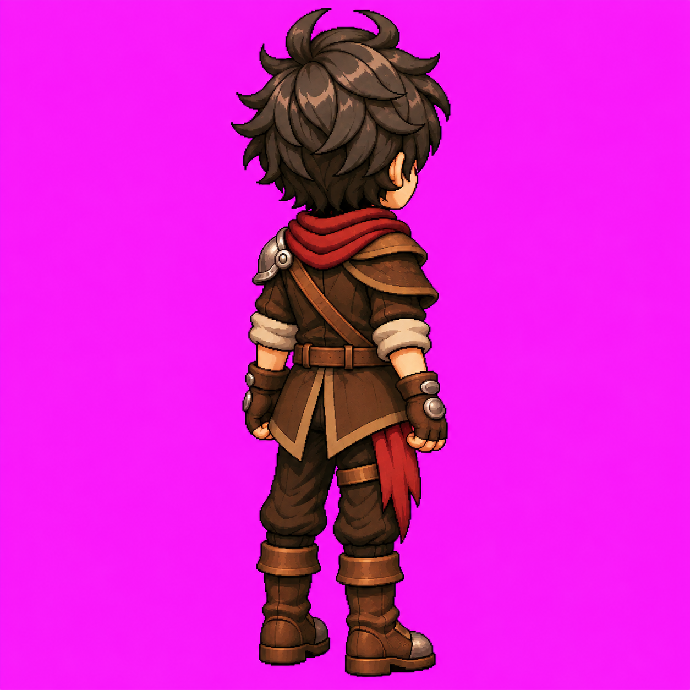

# Louis — Nordeste parado v1

APROVADO E CONGELADO pelo usuário em 10/11/2026. Etapa L3.5.

## L3.5 — Arte Nordeste (NE) aprovada e congelada — 10/11/2026

[Arte NE v1](louis-nordeste-parado-v1.png), [registro](louis-nordeste-parado-v1.md), [metadados e hash](louis-nordeste-parado-v1.json) e [prompt literal](../prompts/louis-nordeste-parado-v1.txt). Pose única em três quartos costas/direita, 1254 × 1254 px, RGB, fundo magenta opaco. Aprovação explícita: “arte aprovada!congele e publique. atualize tbm as documentações + readme seguindo o nosso padrão.” PNG original preservado sem edição, recorte ou redimensionamento; alterações exigem nova versão e aprovação.

Costas v2 + Leste são as autoridades principais; arte frontal e Idle frontal são referências complementares. Lado direito anatômico próximo, ombro de couro; ombreira metálica única à esquerda anatômica, distante e parcialmente visível. Bolsa e adaga anteriores ocultas pelo corpo/casaco; faixa bordô lateral/posterior direita e tira da coxa preservadas. Correia posterior do ombro esquerdo ao quadril direito, sem fivela frontal nas costas. Superfícies intermediárias são interpretações da rotação agora aprovada, sem definir novo ângulo de câmera.

**L3.5 concluída: 7/8 artes estáticas e 6/8 pares arte + Idle (S/N/E/W/SE/SW).** Idle NE e arte + Idle NW pendentes. Próxima etapa proposta: **L3.6 — Idle NE + GIF de validação**, usando a arte NE aprovada e os Idles costas/Leste. Aguardar instrução para produzir. Locomoção, transparência, atlas e validação em motor permanecem pendentes.

## Preservação e procedência

Gerado com image_gen integrado nesta conversa. Referências, nesta ordem: costas v2, Leste v1, arte frontal congelada e Idle frontal. Prompt literal preservado; nenhuma edição posterior à aprovação. Arquivo original: 1496955 bytes; SHA-256: `c90360c5654017782f511487958cc5d273f59343be898ba9554d3f2c1f6de04c`. [Contrato de oclusão](../docs/oclusao-equipamentos.md). Aprovação visual não equivale à validação no motor.
