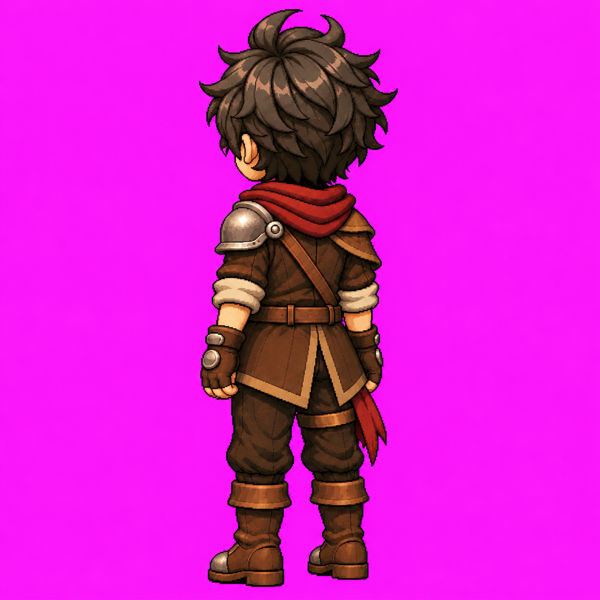

# Louis — Noroeste parado v1

**APROVADO E CONGELADO em 11/11/2026.**

## L3.7 — Arte Noroeste (NW) aprovada e congelada — 11/11/2026

[Arte NW v1](../artes/louis-noroeste-parado-v1.png), [registro](../artes/louis-noroeste-parado-v1.md), [metadados e hash](../artes/louis-noroeste-parado-v1.json) e [prompt literal](../prompts/louis-noroeste-parado-v1.txt). Pose única em três quartos costas/esquerda, 1254 × 1254 px, RGB, fundo magenta opaco. Aprovação explícita: “arte aprovada! congele e publique. atualize também as documentações e readme.” PNG original preservado sem edição, recorte ou redimensionamento; alterações exigem nova versão e aprovação.

Costas v2 + Oeste são as autoridades principais; arte frontal e Idle frontal complementam identidade, proporções e renderização. Ombreira prateada única no lado esquerdo anatômico próximo; couro no ombro direito distante. Correia posterior do ombro esquerdo ao quadril direito, sem fivela frontal nas costas. Bolsa anterior direita e adaga anterior esquerda ocultas pelo corpo/casaco/braços; faixa bordô e tira da coxa mantidas à direita anatômica, com visibilidade independente. Superfícies intermediárias são interpretações da rotação agora aprovada. Não espelhar NE.

**Estado atual: 8/8 artes estáticas aprovadas e 7/8 pares arte + Idle.** Falta o Idle NW. Próxima etapa: **L3.8 — Idle NW + GIF de validação**, usando a arte NW aprovada e os Idles costas/Oeste, mediante instrução. Locomoção nas oito direções continua pendente em L3; transparência, atlas, pivôs e validação no motor em L5.

SHA-256: `e6c9fe0691f6018854ea941f0430211fb1eeeae0f7d63cc861c4456d71b4497c`. Tamanho: 1508827 bytes. Geração com image_gen integrado; nenhum pós-processamento. Validação visual aprovada; integração em motor pendente.
