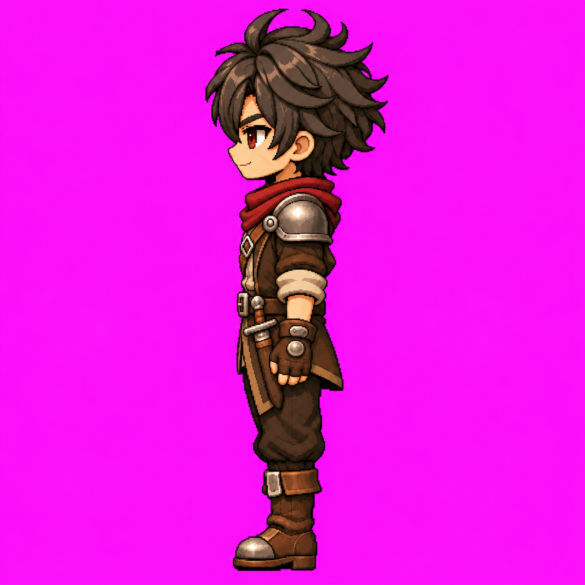

# Louis — Oeste parado v1

**APROVADO E CONGELADO pelo usuário em 10/11/2026.** Aprovação: “ficou boa! congele e publique. atualize os documentos do repositorio também.”

Uma arte estática, direção W (esquerda da tela), 1254 × 1254 px, RGB, magenta opaco. PNG original preservado integralmente; não sobrescrever, recortar ou redimensionar. Mudanças exigem nova versão e aprovação.

## Referências e produção

Gerado com image_gen integrado após leitura da documentação. Referências, nesta ordem: arte frontal congelada, arte Leste parada v1, costas v2 e Idle frontal. [Prompt literal](../prompts/louis-oeste-parado-v1.txt), [metadados](louis-oeste-parado-v1.json). Novas superfícies do lado esquerdo são interpretações agora aprovadas nesta arte.

## Lateralidade e oclusão

Lado esquerdo anatômico próximo da câmera: ombreira metálica única visível; adaga embainhada anterior esquerda visível com sobreposição do braço/mão. Bolsa anterior direita, faixa lateral/posterior direita e tira da coxa direita estão no lado distante, ocultas na pose apresentada. Bochecha esquerda sem a marca exclusiva da direita. Membros distantes sobrepostos no perfil neutro; botas apontando à esquerda. Aplicar sempre o [contrato de oclusão](../docs/oclusao-equipamentos.md). Não é espelhamento da arte E.

## Uso e limites

Autoridade estática W para futuro Idle W, junto das fontes frontal, posterior v2 e E. Não define frames, timing, pivô ou transparência; nenhuma animação W criada ou validação em motor realizada. Aguardar instrução para próxima ação/direção.

SHA-256: `41312cfa0f4491efe9dac6e5b8ef66c6001184444bdc0d51fd3f3337c54a0eb6`. Tamanho: 1416998 bytes.
