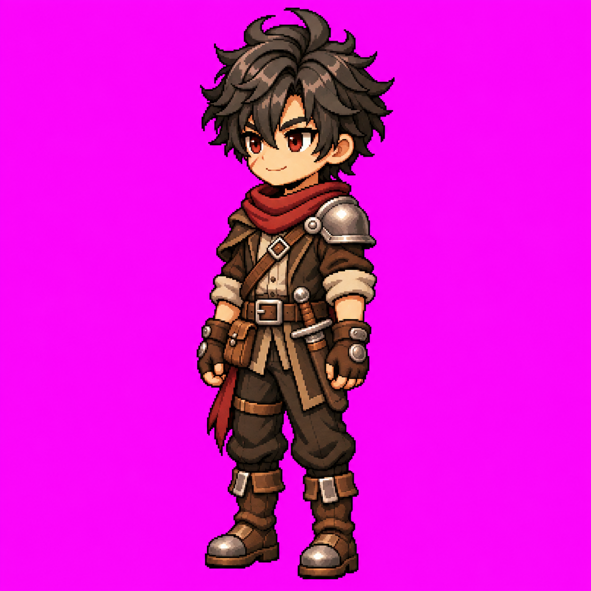

# Louis — Sudoeste parado v1

**APROVADO E CONGELADO pelo usuário em 10/11/2026 — L3.3.**

## L3.3 — Arte Sudoeste (SW) aprovada e congelada — 10/11/2026

[Arte SW v1](louis-sudoeste-parado-v1.png), [registro](louis-sudoeste-parado-v1.md), [metadados e hash](louis-sudoeste-parado-v1.json) e [prompt literal](../prompts/louis-sudoeste-parado-v1.txt). Pose única em três quartos frente/esquerda, 1254 × 1254 px, RGB, fundo magenta opaco. Aprovação explícita do usuário: “aprovado! congele, publique usando github e atualize readme e documentação.” PNG original preservado integralmente, sem edição, recorte ou redimensionamento. Alterações exigem nova versão e aprovação.

Frente + Oeste são as autoridades principais; costas v2 e Idle frontal são referências complementares. Lado esquerdo anatômico próximo: ombreira prateada única e adaga anterior esquerda visíveis, com sobreposição pelo braço. Bolsa anterior direita no lado distante, com projeção parcial; faixa e tira da coxa direitas mantêm seus pontos de fixação. Sem espelhamento automático. As superfícies intermediárias são interpretações da rotação agora aprovada.

**L3.3 concluída: 6/8 artes estáticas e 5/8 pares arte + Idle (S/N/E/W/SE).** SW ainda não possui animação; NE/NW ainda precisam de arte + Idle. Próxima etapa proposta: **L3.4 — Idle SW + GIF de validação**, usando a arte SW aprovada e os Idles frontal/Oeste. Aguardar instrução para produzir. Locomoção e integração no motor permanecem pendentes.

SHA-256: `4b72367d6c1a6c90ebea89824ab8352961ffed05b77414c933fe7403ff846b2a`. Tamanho: 1488828 bytes. Nenhuma animação, transparência, pivô ou validação em motor foi produzida nesta etapa.
